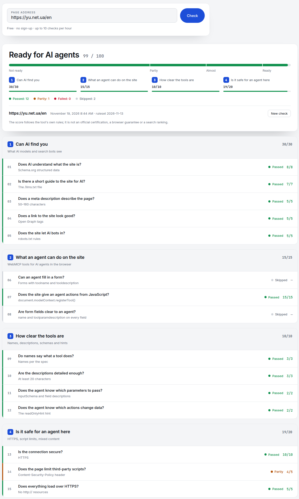

# WebMCP Analyzer

[](LICENSE)
[](composer.json)
[](composer.json)
[](composer.json)
[](https://yu.net.ua/en/tools/webmcp-analyzer)

A Livewire tool for Laravel that checks how ready a site is for AI agents. It finds WebMCP tools declared in forms (`<form toolname="…">`) and registered from JavaScript (`document.modelContext`). It then checks whether an agent can understand and safely call them, and whether AI models can find and understand the site.

It needs no AI and no headless browser: the page and its scripts are analysed statically.



**🔗 Live example: [yu.net.ua/en/tools/webmcp-analyzer](https://yu.net.ua/en/tools/webmcp-analyzer)**

## What it checks

15 checks in four groups. The result is a score out of 100 and a verdict.

| Group | Checks |
|---|---|
| **Can AI find you** | Schema.org description of the site, `/llms.txt`, meta description, link preview tags, AI bots allowed in `robots.txt` |
| **What an agent can do on the site** | Forms an agent can fill in, tools registered from JavaScript, clear form fields |
| **How clear the tools are** | Tool names, description detail, parameter schemas, hints on which actions change data |
| **Is it safe for an agent here** | HTTPS, a policy limiting third-party scripts, no mixed content |

## Requirements

- PHP ^8.4
- Laravel ^13.0
- Livewire ^4.0

## Installation

```bash
composer require yu-laravel/webmcp-analyzer
```

This also installs [`yu-laravel/web-tools-core`](https://github.com/yuriyakishin/laravel-web-tools-core). Both service providers are discovered automatically.

## Usage

Put the component on a page whose layout includes `@livewireStyles` and `@livewireScripts`:

```blade
<livewire:webmcp-analyzer />
```

This tool has no stylesheet of its own. Import the core styles into your CSS build:

```css
@import "../../vendor/yu-laravel/web-tools-core/resources/css/web-tools-core.css";
```

To match your site's colours and fonts, override the `--wt-*` variables (see [Web Tools Core](https://github.com/yuriyakishin/laravel-web-tools-core#styles)).

## Configuration

| Env variable | Default | Description |
|---|---|---|
| `WEBMCP_ANALYZER_ENABLED` | `true` | Turn the tool off without uninstalling it. |
| `WEBMCP_ANALYZER_PER_HOUR` | `10` | Checks per visitor IP per hour. |

A report is cached for 10 minutes. `config/webmcp-analyzer.php` also limits the page size (2 MB) and the scripts read (10 scripts, 1 MB each, 3 MB in total). Page fetching (timeouts, redirects, user agent) is set in [Web Tools Core](https://github.com/yuriyakishin/laravel-web-tools-core#configuration).

## Events

After every check the tool dispatches `Yu\WebToolsCore\Events\ToolCheckedEvent` with `tool = "webmcp-analyzer"` (see [Listening to checks](https://github.com/yuriyakishin/laravel-web-tools-core#listening-to-checks)).

## Languages

13 translations: cs, de, en, es, fr, it, ja, nl, pl, pt, tr, uk and zh. The language is taken from the visitor's browser, with your app locale as the fallback.

## Limitations

The analysis is static. Some tools are registered at run time, for example from a list fetched from an API. They show as "(dynamic)", and the checks on how clear the tools are get skipped for them.

## Author

Yuriy Akishin:
- 🌐 Website: https://yu.net.ua
- 📧 Email: yuriy.akishin@gmail.com
- 💼 LinkedIn: https://www.linkedin.com/in/yuriyakishin/
- 💻 GitHub: https://github.com/yuriyakishin

## License

MIT. See [LICENSE](LICENSE).
